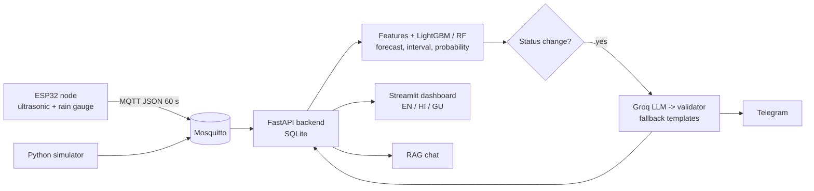

# Vadodara Flood and Waterlogging Early Warning System

   -red)

IoT sensors -> ML forecast of water level **1, 2 and 3 hours ahead** -> alerts in **English, Hindi and Gujarati** written by an LLM (Groq API) from validated facts -> live dashboard + Telegram.

## Table of contents
[Why](#why) · [Features](#features) · [Architecture](#architecture) · [Tech stack](#tech-stack) · [Data and labels](#data-and-labels) · [Results](#results) · [Quick start](#quick-start) · [Configuration](#configuration) · [API](#api) · [Hardware](#hardware) · [Project structure](#project-structure) · [Design decisions](#design-decisions) · [Limitations](#limitations) · [Roadmap](#roadmap) · [Deploy free](#deploy-for-free) · [License](#license)

## Why
Vadodara floods when heavy rain meets a swollen Vishwamitri river (August 2019, August 2024), and underpasses and bridges waterlog within hours. People need a warning 1-3 h ahead, for their own location, in their own language.

## Features
- **Forecast:** water level at +1/+2/+3 h with p10/p50/p90 intervals, plus a calibrated probability that the danger level is crossed within 3 h.
- **Status machine:** safe -> warning -> danger -> safe, with hysteresis so alerts do not flap.
- **Trilingual alerts:** English, Hindi, Gujarati. The LLM sees only a JSON of facts; a validator checks languages, script, length, names, route and that every number is in the facts. If it fails, fixed templates are sent.
- **Chat (RAG):** ask "Is Akota Bridge safe now?" or "Why was the alert sent?" in any of the 3 languages. Answers come only from live data and the alert log.
- **Telegram bot** with de-duplication and rate limiting.
- **Dashboard:** station cards, live level and forecast chart with danger line and interval, map, alert history, model performance page, chat.
- **Runs without hardware:** a sensor simulator publishes the same JSON as the ESP32 firmware.
- **Quality:** causal data cleaning, leakage-tested features, time-based split, 45 pytest tests.

## Architecture


## Tech stack
| Layer | Tools |
|---|---|
| Data / ML | pandas, NumPy, scikit-learn, LightGBM, TensorFlow (GRU, comparison only), Optuna, SHAP, matplotlib, PyArrow |
| IoT | ESP32, JSN-SR04T, tipping-bucket rain gauge, MQTT (Mosquitto), PlatformIO C++ |
| Backend | FastAPI, Pydantic, SQLite, paho-mqtt |
| LLM | Groq API (OpenAI-compatible); Anthropic optional via `LLM_PROVIDER=anthropic` |
| Dashboard | Streamlit, Plotly, Folium, Noto Sans |
| Ops | Docker Compose, Makefile, pytest |

## Data and labels
| Data | Label | In this repo |
|---|---|---|
| Hourly rainfall | **SYNTHETIC** | Real ERA5 via Open-Meteo: `python -m src.fetch_data` (not downloaded in the build environment) |
| Soil moisture, upstream discharge | **DERIVED** from rain | Real ERA5-Land / GloFAS after `fetch_data` |
| Water level at 3 stations | **SYNTHETIC-TARGET** (rain -> runoff -> drain/river level, with injected sensor spikes, gaps, duplicates) | Always synthetic until you record real sensor or gauge data |
| Rain forecast input (1-6 h) | **DERIVED** (noisy future rain, 25% of rows masked) | Live: Open-Meteo forecast |
| Past flood events (2019, 2024) | **REAL** (news, URLs) | `data/raw/flood_events.csv` |

What was tried and why it failed: `data/raw/SOURCES.md`. Per-column labels: `data/processed/dataset_card.json`. Open-Meteo data is CC BY 4.0: attribute when you use it.

## Results
<!-- RESULTS:START -->
_Data mode: **SYNTHETIC_RAIN__SYNTHETIC_TARGET**. Water levels are **SYNTHETIC-TARGET**. Test = 2025-01-01 to 2025-12-31 (25,154 rows, never used for tuning). Measured 2026-11-22 20:33:22._

**Water level forecast, TEST (cm; lower is better)**

| Model | MAE +1h | MAE +2h | MAE +3h | RMSE +3h | R2 +3h |
|---|---|---|---|---|---|
| Persistence | 1.03 | 1.17 | 1.30 | 3.68 | 0.942 |
| LinearTrend | 1.18 | 1.52 | 1.89 | 3.78 | 0.939 |
| LightGBM | 0.76 | 0.81 | 0.82 | 1.96 | 0.984 |
| RandomForest | 0.74 | 0.79 | 0.83 | 2.12 | 0.981 |
| GRU (24h window) | 0.80 | 0.91 | 1.00 | 2.85 | 0.966 |

**Flood within 3 h, TEST** (hourly metrics on rows not yet above danger; events = flood episodes, lead time over detected events)

| Model | Precision | Recall | F1 | PR-AUC | ROC-AUC | Brier | False-alarm ratio | Events detected | Mean lead (min) | False-alarm episodes |
|---|---|---|---|---|---|---|---|---|---|---|
| Persistence (levels->flag) | 0.000 | 0.000 | 0.000 | 0.091 | 0.988 | - | - | 0/10 | 0 | 0/10 |
| LinearTrend (levels->flag) | 0.667 | 0.467 | 0.549 | 0.482 | 0.992 | - | 0.333 | 8/10 | 105 | 6/16 |
| LightGBM (levels->flag) | 0.778 | 0.700 | 0.737 | 0.798 | 0.999 | - | 0.222 | 9/10 | 147 | 5/16 |
| RandomForest (levels->flag) | 0.944 | 0.567 | 0.708 | 0.747 | 0.998 | - | 0.056 | 9/10 | 127 | 1/13 |
| GRU (levels->flag) | 0.818 | 0.300 | 0.439 | 0.522 | 0.995 | - | 0.182 | 5/10 | 108 | 1/11 |
| LightGBM classifier (calibrated) | 0.718 | 0.933 | 0.812 | 0.886 | 1.000 | 0.00031 | 0.282 | 10/10 | 168 | 6/19 |
| RandomForest classifier (calibrated) | 0.426 | 0.967 | 0.592 | 0.864 | 1.000 | 0.00037 | 0.574 | 10/10 | 180 | 17/37 |

**Prediction interval (quantile LightGBM, nominal 80% = p10-p90), TEST**

| Horizon | Coverage | Mean width (cm) | Median MAE (cm) |
|---|---|---|---|
| +1h | 0.793 | 2.90 | 0.76 |
| +2h | 0.791 | 2.93 | 0.81 |
| +3h | 0.793 | 3.02 | 0.82 |

**Walk-forward CV (train period only, +3 h MAE, cm)**

| Fold | Train rows | LightGBM | Persistence |
|---|---|---|---|
| 0 | 65,639 | 0.85 | 1.19 |
| 1 | 131,492 | 0.88 | 1.32 |
| 2 | 197,345 | 0.76 | 1.12 |
| 3 | 263,198 | 1.00 | 1.42 |

Deployed regressor: **RandomForest** (best mean validation MAE). Deployed classifier: **LightGBM classifier**, isotonic-calibrated, threshold **0.364** (max F2 on validation PR curve). GRU: trained; evaluated on 24,786/25,154 test rows (rows with a full 24 h window).
<!-- RESULTS:END -->

Read with care: persistence is hard to beat on average because levels are flat most of the time; the gain is in the rare rises. The test year has only a handful of flood episodes, so recall, lead time and false-alarm numbers have wide error bars. The synthetic target comes from simple equations the model can partly re-learn, so real-world scores will be lower.
More: `docs/error_analysis.md`, `docs/figures/` (SHAP, PR curves, reliability, example event), `notebooks/01_eda_and_model_comparison.ipynb`, `docs/REPORT.md`.

## Quick start
### Option A: Docker (one command)
```bash
git clone <your-repo-url> && cd vadodara-flood-ews
cp env.example .env          # Windows: copy env.example .env   (then edit it)
docker compose up --build
```
- Dashboard: http://localhost:8501
- API docs: http://localhost:8000/docs (header `X-API-Key`, default `dev-key`)

The simulator replays a heavy-rain scenario in a loop: calm -> warning -> danger -> safe.

### Option B: without Docker
Needs Python 3.11+ and an MQTT broker ([Mosquitto](https://mosquitto.org/download/)).
```bash
python -m venv .venv && source .venv/bin/activate     # Windows: .venv\Scripts\activate
pip install -r requirements.txt

mosquitto -c mosquitto/mosquitto.conf                  # terminal 1
# terminal 2 (Windows PowerShell: use $env:NAME="value")
MQTT_HOST=localhost ALLOW_SIM_TIME=1 EVAL_INTERVAL_S=1 API_KEY=dev-key uvicorn backend.app.main:app --port 8000
python -m iot.simulator --mqtt-host localhost --speed 1                       # terminal 3
API_URL=http://localhost:8000 API_KEY=dev-key streamlit run dashboard/app.py  # terminal 4
```
Without `make` (Windows), use the `python -m ...` commands below. With `make`: `make api`, `make sim`, `make dash`.

### Rebuild data, retrain, test
```bash
python -m src.build_dataset            # make data       (seeded, reproducible)
python -m src.train --trials 10        # make train      (~10 min on 1 CPU; add --skip-gru to skip TensorFlow)
python -m src.analyze                  # make analyze    (error analysis)
python -m src.report                   # make report     (writes measured results into this README)
python -m pytest -q tests              # make test       (45 tests)
```

### Use real rainfall
```bash
python -m src.fetch_data               # needs internet; writes data/raw/*.csv and SOURCES.md
python -m src.build_dataset --require-real
python -m src.train --trials 10
```
Rainfall becomes REAL; water level stays SYNTHETIC-TARGET until you add real sensor or gauge data.

## Configuration
Copy `env.example` to `.env` (never commit it). Everything is optional: without keys, alerts use validated templates and Telegram is skipped.

| Variable | Purpose |
|---|---|
| `API_KEY` | Key for the REST API (default `dev-key` is insecure) |
| `GROQ_API_KEY`, `GROQ_MODEL` | LLM for alerts and chat (default model `llama-3.3-70b-versatile`) |
| `LLM_PROVIDER` | `groq` (default) or `anthropic` (needs `ANTHROPIC_API_KEY`, `pip install anthropic`) |
| `TELEGRAM_BOT_TOKEN`, `TELEGRAM_CHAT_ID` | Telegram alerts |
| `FORECAST_SOURCE` | `mqtt` (simulator) or `openmeteo` (real forecast, for real sensors) |
| `ALLOW_SIM_TIME` | `1` only with the simulator (it runs faster than real time) |

Stations (name in 3 languages, coordinates, danger level, alternative route) live in `config/stations.yaml`.

## API
All endpoints except `/health` need header `X-API-Key`.
| Endpoint | Description |
|---|---|
| `GET /health` | DB, model and MQTT status |
| `GET /stations` | Stations with current status |
| `GET /readings?station=akota&limit=200` | Stored readings |
| `GET /forecast/{station}` | Forecast, interval, probability, ETA |
| `GET /alerts` | Alert history (3 languages, source, Telegram result) |
| `POST /ingest` | Send one reading (HTTP alternative to MQTT) |
| `POST /chat` | `{"question": "Is Akota Bridge safe now?"}` |
| `GET /model/metrics` | Contents of `models/metrics.json` |

MQTT message (same from firmware and simulator), topic `flood/<station>/telemetry`:
```json
{"station":"akota","level_cm":85.4,"rain_mmh":12.0,"battery_v":3.9,"ts":"2026-07-01T10:00:00+05:30"}
```

## Hardware
ESP32 + JSN-SR04T waterproof ultrasonic sensor + tipping-bucket rain gauge + solar and 18650 battery, about INR 4,000-8,000 per station. Wiring and bill of materials: [`docs/HARDWARE.md`](docs/HARDWARE.md). Firmware: `firmware/esp32/` (PlatformIO). **Not compiled or tested on hardware yet.**

## Project structure
```
config/      stations.yaml
data/        raw/ (SOURCES.md, flood_events.csv), synthetic/, processed/
src/         clean, features, train, predict, alerts, llm, rag, level_sim, synth, fetch_data, analyze, report
models/      flood_model.joblib, metadata.json, metrics.json
backend/     FastAPI app, SQLite, Telegram, service logic
iot/         sensor simulator
firmware/    ESP32 PlatformIO project
dashboard/   Streamlit app (EN / HI / GU)
mosquitto/   broker config        docker/   Dockerfiles
tests/       pytest (45 tests)    notebooks/  EDA + model comparison
docs/        REPORT.md, HARDWARE.md, error_analysis.md, figures/
```

## Design decisions
- **Time split, never shuffled:** train 2010-2022, validation 2023-2024 (tuning, calibration, threshold), test 2025. Walk-forward CV with a gap. Optuna uses validation only.
- **Causal cleaning and features:** nothing from the future is used; a unit test checks that changing the future does not move any feature.
- **Imbalance:** about 1% of hours are flood-labelled. Class weights, isotonic calibration, threshold from the validation PR curve (max F2, recall-favoured). Water above 85% of danger is never reported `safe`.
- **Alerts cannot invent facts:** see Features. The API key is read from the environment only.

## Limitations
- Synthetic data (see top). Validate on real data first.
- Hourly resolution; very fast rises (<1 h) are hard to catch. No Ajwa dam release input, which mattered in 2024.
- SQLite lite mode. The Mosquitto demo config allows anonymous clients: add passwords and TLS for production.
- Docker Compose files and ESP32 firmware were **not executed in the build environment**. The same stack (Mosquitto + API + simulator) was run natively and worked end to end.
- The Groq and Telegram integrations were tested with mocks only. Hindi and Gujarati quality from the LLM is not guaranteed; the validator falls back to templates when a draft fails.

## Roadmap
- Train on real ERA5 / GloFAS rainfall and calibrate on installed sensors.
- Add Ajwa and Pratappura dam release data; 10-minute resolution.
- TimescaleDB, MQTT auth + TLS, store-and-forward on the ESP32.
- Two-way Telegram bot, SMS / WhatsApp alerts.

## Deploy for free
Render (API + dashboard, sleeps when idle), Oracle Cloud Always Free (always-on VM running `docker compose`), Streamlit Community Cloud (dashboard only). Free tiers change often: check each provider's current limits.

## License
Add a `LICENSE` file before publishing (MIT is a common choice). Data from Open-Meteo is CC BY 4.0.

## Acknowledgements
Open-Meteo (ERA5, GloFAS), Groq, LightGBM, SHAP, FastAPI, Streamlit. Flood event facts come from the news pages linked in `data/raw/flood_events.csv`.
